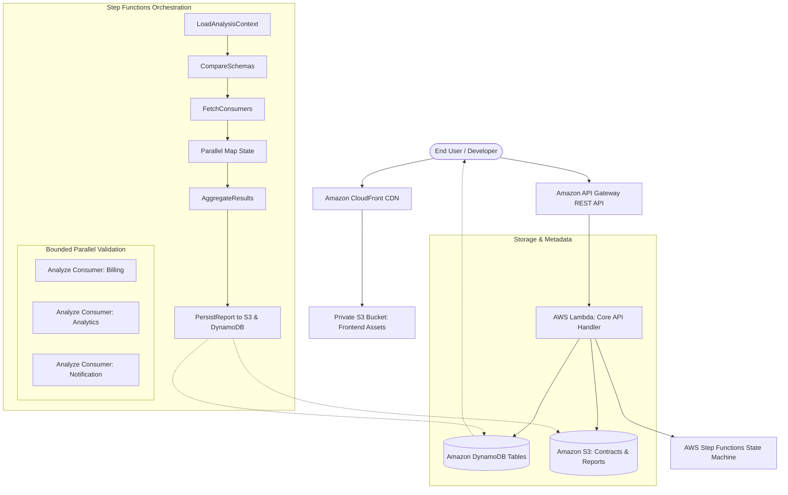

# SchemaShield — The Serverless Data Contract Firewall

[](https://aws.amazon.com/serverless/)
[](https://aws.amazon.com/step-functions/)
[](https://aws.amazon.com/dynamodb/)
[](https://www.python.org/)
[](https://react.dev/)
[](https://community.aws/)

> **Weekend Challenge:** *No Pipeline, No Problem*  
> **Tagline:** Catch breaking data contracts before they break production.

---

## 1. Problem Statement & Why SchemaShield Exists

In modern distributed microservice and event-driven architectures, upstream teams frequently modify their data contracts (e.g. renaming fields, altering data types, removing enum options, or making optional properties required) without full visibility into downstream dependencies.

### The Upstream/Downstream Dilemma
An upstream **Orders Service** publishes:
```json
{
  "order_id": "ORD-101",
  "customer_id": "C-101",
  "total": 5000,
  "currency": "PKR",
  "created_at": "2026-11-16T18:00:00Z",
  "customer_email": "user@example.com"
}
```

Three independent downstream services consume this contract:
1. **Billing Service:** Requires `order_id`, `customer_id`, `total` (numeric), and `currency`.
2. **Analytics Warehouse:** Requires `order_id`, `customer_id`, `total` (numeric), and `created_at`.
3. **Customer Notification Service:** Only requires `order_id` and `customer_email`.

When an upstream developer renames `customer_id` to `buyer_id` or turns `total` into a formatted string (`"$5,000"`), upstream unit tests pass. But once deployed to production, downstream Billing and Analytics pipelines crash, halting revenue reporting and customer transactions.

**SchemaShield acts as a serverless data contract firewall.** It intercepts proposed schema changes, performs deterministic compatibility evaluations, executes parallel downstream contract checks via AWS Step Functions, visualizes the downstream blast radius, and provides actionable remediation guidance before changes reach production.

---

## 2. High-Level Architecture Diagram



---

## 3. AWS Services and Responsibilities

- **Amazon API Gateway:** Serves public REST API endpoints with CORS preflight and request validation.
- **AWS Lambda (Python 3.12):** Executes stateless schema comparison and compatibility engines using a shared layer.
- **AWS Step Functions:** Asynchronously orchestrates the analysis workflow. Uses a parallel `Map` state (`MaxConcurrency: 5`) to check consumers simultaneously without API timeout limits.
- **Amazon DynamoDB (On-Demand):** Pay-per-request tables for contracts, consumers, and analysis history. Scales to zero.
- **Amazon S3:** Dedicated private bucket with server-side encryption storing schema versions and durable JSON audit reports.
- **Amazon CloudFront + Origin Access Control (OAC):** High-speed edge CDN securely serving the compiled React frontend from private S3 storage.
- **AWS SAM & CloudFormation:** Full Infrastructure-as-Code enabling reproducible deployment with **No Pipeline, No Problem**.

---

## 4. Deterministic Compatibility Engine (No LLMs)

SchemaShield enforces strict, deterministic **JSON Schema Draft 2020-12** evaluation rules. No Large Language Models are used, ensuring 100% reproducible, explainable, and testable decisions.

### Change Classification Rules:
- **BREAKING Changes:**
  - Removing a property or renaming a field.
  - Incompatible type mutation (e.g. `number` $\rightarrow$ `string`).
  - Removing an allowed enum value (narrowing producer choices).
  - Removing a field from producer's `required` guarantee when consumers depend on it.
- **RISKY Changes:**
  - Adding newly required fields.
  - Narrowing `additionalProperties` to `false`.
- **SAFE Changes:**
  - Adding optional properties.
  - Expanding enum options.
  - Compatible description or title metadata updates.

---

## 5. Explainable Risk Scoring Methodology

Risk scores range from **0 to 100**:

$$\text{Raw Score} = \sum (\text{Severity Weights}) + (25 \times \text{Breaking Consumers}) + (10 \times \text{Warning Consumers})$$

- **Critical:** 30 pts | **High:** 20 pts | **Medium:** 10 pts | **Low:** 3 pts
- **Verdicts:**
  - `0–19`: **LOW RISK**
  - `20–49`: **MODERATE RISK**
  - `50–79`: **HIGH RISK**
  - `80–100`: **CRITICAL RISK**
- **Rule:** If *any* consumer has a confirmed breaking incompatibility, the release verdict is unconditionally:
  $$\mathbf{BLOCK\ RELEASE}$$

---

## 6. One-Command Deployment ("No Pipeline, No Problem")

In adherence to the challenge theme, there is **no external CI/CD pipeline** (no GitHub Actions, CodePipeline, or Jenkins).

### Prerequisites
- AWS CLI configured (`aws configure` with an IAM user having serverless permissions)
- AWS SAM CLI installed
- Python 3.12+
- Node.js 18+ and npm

### Deploy with Bash:
```bash
./scripts/deploy.sh
```

### Deploy with Windows PowerShell:
```powershell
.\scripts\deploy.ps1
```

The script automatically:
1. Validates environment credentials and tools.
2. Runs all 14 backend unit tests.
3. Builds the React + TypeScript frontend (`npm run build`).
4. Validates and builds SAM infrastructure.
5. Deploys the CloudFormation stack (`schemashield`).
6. Synchronizes frontend assets to the private S3 bucket.
7. Executes a live health check and outputs CloudFront & API endpoints.

---

## 7. Local Development

### Run Backend Tests
```bash
python -m unittest tests/backend/test_core_engines.py
```

### Run Frontend Locally
```bash
cd frontend
npm install
npm run dev
```
Open `http://localhost:3000`. In local mode, the frontend automatically falls back to an in-memory simulation engine if the live AWS API is offline.

---

## 8. API Reference Summary

| Method | Endpoint | Description |
| :--- | :--- | :--- |
| `GET` | `/api/health` | Service heartbeat and uptime |
| `POST` | `/api/demo/seed` | Idempotently provisions Order Events demo data |
| `GET` | `/api/contracts` | Lists all registered data contracts |
| `POST` | `/api/contracts` | Registers a new data contract |
| `GET` | `/api/contracts/{id}` | Inspects active contract schema |
| `GET` | `/api/contracts/{id}/consumers` | Lists downstream consumers for contract |
| `POST` | `/api/contracts/{id}/analyze` | Initiates Step Functions analysis execution |
| `GET` | `/api/analyses` | Lists historical analysis runs |
| `GET` | `/api/analyses/{id}` | Gets status and risk score of an analysis |
| `GET` | `/api/analyses/{id}/report` | Fetches durable JSON report from Amazon S3 |

---

## 9. Interactive Demonstration Walkthrough

1. Open the application URL in any browser.
2. Click **LOAD INTERACTIVE DEMO** on the top navigation bar or dashboard banner.
3. Notice the **Order Events** contract created with 3 consumers:
   - **Billing Service** (needs `customer_id`, `total` as number, `currency`)
   - **Analytics Warehouse** (needs `customer_id`, `total` as number, `created_at`)
   - **Customer Notification Service** (needs `order_id`, `customer_email`)
4. Click **Inspect Contract & Analyze**.
5. Click **Load Breaking Scenario** to simulate:
   - `customer_id` renamed to `buyer_id`
   - `total` mutated from `number` to `string`
   - `currency` narrowed to `USD` only
   - `discount_code` added
6. Click **Run Contract Firewall Analysis**.
7. Observe the results:
   - **Verdict:** `BLOCK RELEASE` (Risk Score: 85/100)
   - **Billing Service:** `BREAKING` (red)
   - **Analytics Warehouse:** `BREAKING` (red)
   - **Customer Notification Service:** `COMPATIBLE` (green!)
   - **Downstream Blast Radius:** Interactive topology graph isolating affected consumers.
   - **Actionable Fixes:** Suggestions to maintain `customer_id` alias and preserve numeric type.

---

## 10. Cost Considerations & Scale-to-Zero

SchemaShield has no long-running virtual machines, idle containers, or open database connections.
- When inactive, AWS resource consumption drops to **$0.00/hour**.
- CloudFront, S3, DynamoDB, API Gateway, and Lambda only accrue charges on active requests.

---

## 11. Limitations of the MVP & Future Roadmap

- **MVP Scope:** Focused on JSON Schema Draft 2020-12.
- **Future Improvements:**
  - Support for Apache Avro and Protocol Buffers (Protobuf).
  - Webhook integration to post analysis verdicts directly to GitHub/GitLab Pull Requests.
  - Automatic synthetic contract test generation.

---

## License
MIT License. Created for the AWS Builder Center Weekend Challenge: "No Pipeline, No Problem".
