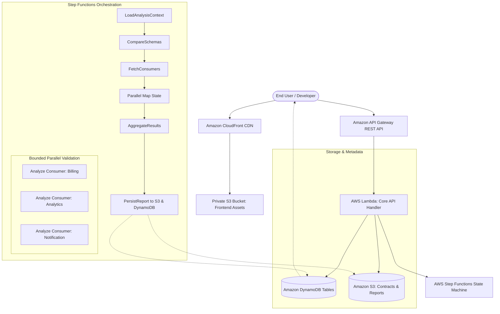

# SchemaShield Architecture & Technical Specification

> **Weekend Challenge:** No Pipeline, No Problem (AWS Builder Center)  
> **Product:** SchemaShield — The Serverless Data Contract Firewall

---

## 1. System Overview & Problem Statement

Modern microservice architectures experience frequent production outages due to **uncoordinated schema evolution**. When an upstream producer (e.g., Orders Service) modifies a data contract (such as renaming `customer_id` to `buyer_id`, or changing `total` from a numeric float to a string), downstream consumers (e.g., Billing, Analytics, Notifications) break in production.

**SchemaShield** acts as an automated serverless firewall. It evaluates proposed schema changes *before* they are released, performs deterministic schema compatibility analysis, orchestrates consumer checks in parallel via AWS Step Functions, computes an explainable risk score (0–100), visualizes downstream blast radius, and provides actionable remediation guidance.

---

## 2. Architecture Diagram (Mermaid)



---

## 3. AWS Services and Responsibilities

| Service | Responsibility in SchemaShield |
| :--- | :--- |
| **Amazon API Gateway** | Public REST API endpoints with CORS preflight, request validation, and least-privilege IAM proxy integration. |
| **AWS Lambda** | Stateless Python 3.12 computation workers using a shared Core Engine Layer for deterministic JSON Schema Draft 2020-12 diffing and compatibility analysis. |
| **AWS Step Functions** | Asynchronous workflow orchestration. Decouples API latency from deep compatibility analysis. Uses a parallel `Map` state to validate all registered downstream consumers simultaneously. |
| **Amazon DynamoDB** | Pay-per-request (on-demand) tables storing metadata for contracts, consumers, and analysis history. Scales to zero. |
| **Amazon S3** | Dedicated private storage bucket storing versioned schemas, proposed schemas, and durable execution audit reports. |
| **Amazon CloudFront** | Edge CDN with Origin Access Control (OAC) delivering the compiled React + TypeScript frontend securely from a private S3 origin. |
| **AWS CloudWatch** | Structured logging, metrics, and trace telemetry for all Lambda functions. |
| **AWS SAM & CloudFormation** | Pure Infrastructure-as-Code enabling one-command repeatable deployment without maintaining external CI/CD pipelines. |

---

## 4. Deterministic Schema Compatibility Logic

SchemaShield enforces strict, deterministic JSON Schema Draft 2020-12 rules. **No Large Language Models (LLMs) are used for compatibility decisions**, guaranteeing 100% testable, explainable, and reproducible outcomes.

### 4.1 Schema-Level Change Categorization
- **BREAKING Changes**:
  - Property removal or renaming.
  - Incompatible type changes (e.g., `number` $\rightarrow$ `string`, `string` $\rightarrow$ `integer`).
  - Narrowing allowed enum values (e.g., removing `PKR` from `["USD", "PKR"]`).
  - Removing a required field constraint from producer guarantee (producer no longer guarantees field presence).
- **RISKY Changes**:
  - Adding newly required fields (consumers or upstream producers might fail to supply it).
  - Restricting `additionalProperties` to `false`.
- **SAFE Changes**:
  - Adding optional properties.
  - Expanding enum values (adding new valid options).
  - Metadata, description, or title updates.

### 4.2 Consumer-Level Compatibility Rules
For each downstream consumer, the engine verifies:
1. **Guaranteed Fields**: Every field in the consumer's `required` array must be present in the producer schema *and* guaranteed in the producer's `required` array.
2. **Type Compatibility**: Types must match identically, or safely widen (e.g., consumer expects `number`, producer supplies `integer`).
3. **Enum Subsets**: If consumer defines enum constraints, producer values must not violate them.
4. **Additional Property Restrictions**: If consumer specifies `additionalProperties: false`, undeclared producer properties trigger a warning.

---

## 5. Explainable Risk Scoring Methodology

The risk score is a deterministic integer between 0 and 100 calculated from schema changes and consumer blast radius:

$$\text{Raw Score} = \sum (\text{Severity Weights}) + (25 \times \text{Breaking Consumers}) + (10 \times \text{Warning Consumers})$$

Where weights are:
- **Critical Finding**: 30 points
- **High Finding**: 20 points
- **Medium Finding**: 10 points
- **Low Finding**: 3 points

### Release Verdict Rules:
- **BLOCK RELEASE**: Triggered whenever any registered downstream consumer is `BREAKING`, regardless of score.
- **REVIEW REQUIRED**: Triggered when non-breaking warnings or high severity changes are present.
- **SAFE TO RELEASE**: Triggered when all registered consumers are fully compatible.

---

## 6. Data Storage & Schema Organization

### DynamoDB Tables (PAY_PER_REQUEST)
1. **ContractsTable** (`schemashield-contracts`):
   - Partition Key: `contractId` (String)
   - Attributes: `name`, `description`, `domain`, `currentVersion`, `schemaS3Key`, `createdAt`, `updatedAt`
2. **ConsumersTable** (`schemashield-consumers`):
   - Partition Key: `contractId` (String), Sort Key: `consumerId` (String)
   - Attributes: `name`, `type`, `expectedSchemaS3Key`, `createdAt`, `updatedAt`
3. **AnalysesTable** (`schemashield-analyses`):
   - Partition Key: `analysisId` (String)
   - Attributes: `contractId`, `status`, `riskScore`, `verdict`, `findingsSummary`, `affectedConsumers`, `reportS3Key`, `executionArn`, `createdAt`, `completedAt`

### S3 Directory Structure
```text
schemashield-storage-{AccountId}-{Region}/
├── contracts/
│   └── {contractId}/
│       └── versions/
│           └── v1.json
├── consumers/
│   └── {contractId}/
│       └── {consumerId}.json
├── proposals/
│   └── {contractId}/
│       └── {analysisId}.json
└── reports/
    └── {contractId}/
        └── {analysisId}.json
```

---

## 7. Cost Considerations & Scale-to-Zero

SchemaShield has no long-running servers, no EC2 instances, and no NAT gateways:
- **API Gateway & Lambda**: Zero cost when not invoked.
- **DynamoDB**: On-Demand capacity ensures zero idle table cost.
- **S3 & CloudFront**: Pay only for actual storage bytes and edge data transfer.
- **Step Functions**: Billed per state transition; zero cost when idle.
